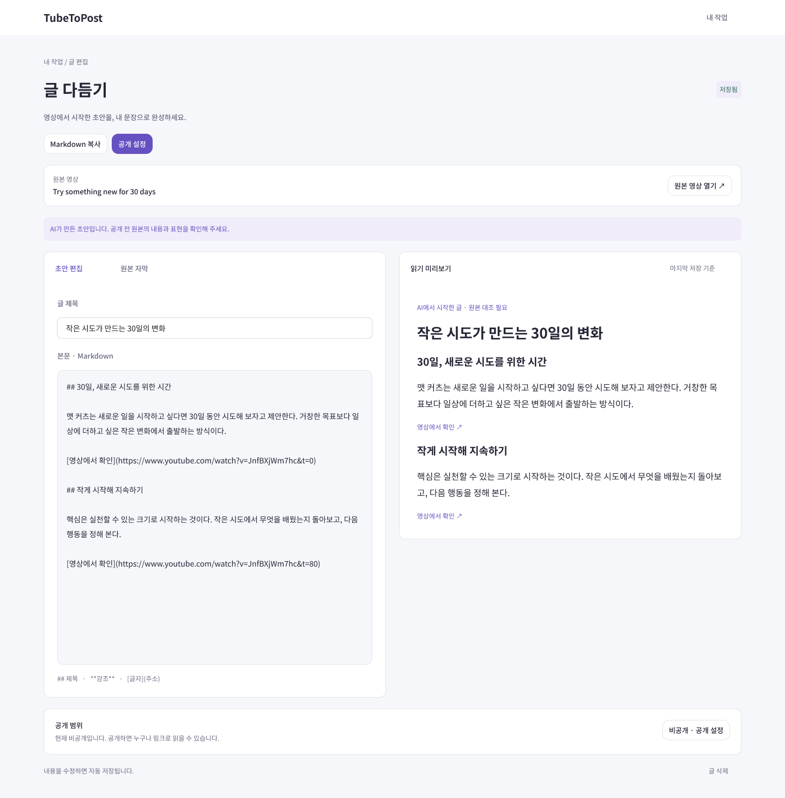
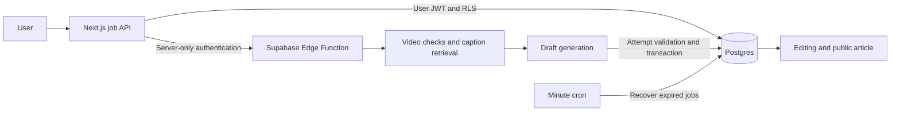

# TubeToPost

<p align="right"><sub><a href="README.md">한국어</a> · English</sub></p>

**Turn YouTube captions into editable Korean blog drafts.**

TubeToPost connects video URL submission, caption retrieval, asynchronous draft generation, editing, and publication. Generated text stays a draft: authors compare it with the source before publishing.

<p>
  <a href="https://tubetopost.vercel.app/demo"></a>
  <a href="https://tubetopost.vercel.app/project"></a>
  <a href="https://github.com/LibrumLego/tubetopost"></a>
</p>

## Product preview

<table>
  <tr>
    <td width="58%"><a href="https://tubetopost.vercel.app/demo"></a></td>
    <td width="42%"><a href="https://tubetopost.vercel.app/post/exploring-procrastin"></a></td>
  </tr>
  <tr>
    <td align="center"><sub>Draft editor and reading preview</sub></td>
    <td align="center"><sub>Article reviewed against its source</sub></td>
  </tr>
</table>

## Portfolio walkthrough

1. [Login-free demo](https://tubetopost.vercel.app/demo) — edit the sample title and Markdown in the browser. It does not call the generation API or save changes.
2. [Reviewed public article](https://tubetopost.vercel.app/post/exploring-procrastin) — read a result checked against its source video.
3. [Engineering case study](https://tubetopost.vercel.app/project) — see the design decisions for background jobs, edit conflicts, access control, and cost limits.
4. [GitHub source](https://github.com/LibrumLego/tubetopost)

## Engineering decisions

| Problem | Implementation | Evidence |
| --- | --- | --- |
| Duplicate or stale completion of long-running jobs | Persisted job states, attempt IDs, lease checks, transactional finalization | [Reliability design and verification](docs/reliability.md) |
| Interrupted or expired jobs | Expiration recovery and bounded user retries | [Worker guide](docs/worker.md) |
| Concurrent edits from multiple screens | Revision-based saves; return `409` on conflict | [Reliability design and verification](docs/reliability.md) |
| Access control, untrusted content, and API cost | Supabase RLS, output sanitization, request limits, and cost reservation before model calls | [Security review](docs/security-review-2026-10-16.md) |
| Caption-provider outages versus missing captions | Distinguish provider outcomes and retain diagnostic detail | [Transcript validation log](docs/transcript-poc-log.md) |

`after` and `waitUntil` are not durable queues. The app does not promise automatic job replay; it stores job state in the database and uses expiration recovery plus manual retries.

## Architecture



## Stack

Next.js 16 App Router · React 19 · TypeScript · Tailwind CSS v4 · Supabase Auth / Postgres / Edge Functions · Supadata · OpenAI `gpt-4o-mini` · Vercel

## Verification and limits

Project records include completed conversions for TED and TypeScript videos, input-limit checks, edit-conflict checks, and database permission and recovery checks. As recorded on 2026-10-28, lint, TypeScript, production build, Deno worker tests, and regression scripts passed. See [reliability verification](docs/reliability.md), [deployment records](docs/deployment.md), and the [security review](docs/security-review-2026-10-16.md) for details.

- Conversion and editing require email magic-link sign-in. Only the sample demo is login-free.
- The app declines conversion when captions are unavailable or video duration cannot be verified.
- A durable queue, automatic replay, and Whisper fallback are not implemented.
- Generated text is not guaranteed to be factually accurate; people should review numbers, translations, and terminology.
- Large-scale quality evaluation across many users and video types has not been performed.

AI tools were used as implementation and review aids. No unmeasured claims are made about user counts, revenue, processing speed, or output quality.

## Run locally

```sh
pnpm install --frozen-lockfile
cp .env.local.example .env.local
# Add the required service values to .env.local
pnpm env:check
pnpm dev
```

A Supabase project and Edge Function configuration are required. See the [deployment guide](docs/deployment.md) for migrations, auth callbacks, and environment variables. Keep keys and secrets in `.env.local`; do not commit them.

```sh
pnpm lint
pnpm build
pnpm worker:check
deno test --config supabase/functions/process-job/deno.json --allow-env --allow-net --allow-read supabase/functions/process-job/worker_test.ts
```
