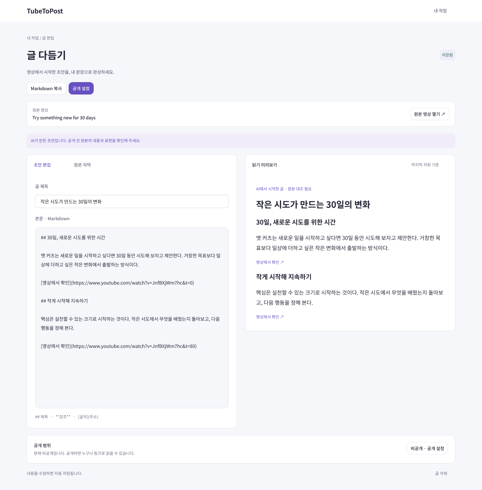
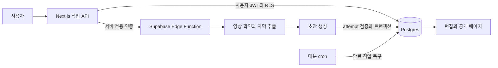

# TubeToPost

<p align="right"><sub>한국어 · <a href="README.en.md">English</a></sub></p>

**YouTube 자막을 검수하고 편집할 수 있는 한국어 블로그 초안으로 바꾸는 웹 서비스**

영상 URL 입력부터 자막 추출, 비동기 생성, 글 편집과 공개 페이지까지 연결했습니다. 생성 결과를 완성된 사실로 취급하지 않고, 사람이 원문과 대조해 편집한 뒤 공개하는 흐름을 제공합니다.

<p>
  <a href="https://tubetopost.vercel.app/demo"></a>
  <a href="https://tubetopost.vercel.app/project"></a>
  <a href="https://github.com/LibrumLego/tubetopost"></a>
</p>

## 먼저 둘러보기

1. [로그인 없는 데모](https://tubetopost.vercel.app/demo) — 샘플 글을 살펴보고 제목과 Markdown을 브라우저에서 편집합니다. 실제 생성 요청이나 저장은 하지 않습니다.
2. [검수해 공개한 글](https://tubetopost.vercel.app/post/exploring-procrastin) — 원문 대조 후 공개한 결과물입니다.
3. [기술 사례 설명](https://tubetopost.vercel.app/project) — 비동기 작업, 저장 충돌, 권한과 비용 제어의 설계 선택을 확인합니다.
4. [GitHub 소스 코드](https://github.com/LibrumLego/tubetopost)

## 제품 화면

<table>
  <tr>
    <td width="58%"><a href="https://tubetopost.vercel.app/demo"></a></td>
    <td width="42%"><a href="https://tubetopost.vercel.app/post/exploring-procrastin"></a></td>
  </tr>
  <tr>
    <td align="center"><sub>초안 편집기와 읽기 미리보기</sub></td>
    <td align="center"><sub>원문 대조 후 공개한 글</sub></td>
  </tr>
</table>

<p align="center">
  
  
  
  
</p>

## 구현에서 다룬 문제

| 문제 | 구현 | 확인 자료 |
| --- | --- | --- |
| 오래 걸리는 생성 작업의 중복·지연 완료 | DB 작업 상태, attempt ID와 lease 검증, 트랜잭션 완료 처리 | [안정성 설계와 검증](docs/reliability.md) |
| 중단되거나 만료된 작업 | 만료 상태 복구와 사용자의 제한된 재시도 | [워커 안내](docs/worker.md) |
| 여러 화면에서 같은 글을 편집 | revision 기반 저장, 충돌 시 `409` 응답 | [안정성 설계와 검증](docs/reliability.md) |
| 권한 우회, 원문 콘텐츠, 호출 비용 | Supabase RLS, 출력 정제, 요청 제한과 모델 호출 전 비용 예약 | [보안 검토](docs/security-review-2026-10-16.md) |
| 자막 공급자 장애와 자막 미제공 구분 | 공급자 결과를 구분하고 진단 정보를 기록 | [자막 검증 기록](docs/transcript-poc-log.md) |

`after`와 `waitUntil`은 영속 큐가 아니므로 자동 재실행을 보장하지 않습니다. 작업 상태를 DB에 보관하고 만료 복구와 수동 재시도로 중단에 대응합니다.

## 구조



## 기술 스택

Next.js 16 App Router · React 19 · TypeScript · Tailwind CSS v4 · Supabase Auth / Postgres / Edge Functions · Supadata · OpenAI `gpt-4o-mini` · Vercel

## 검증과 한계

프로젝트 기록에는 TED와 TypeScript 영상의 실제 변환, 입력 제한, 편집 충돌 및 DB 권한·복구 검증이 남아 있습니다. 2026-10-28 기록 기준으로 lint, TypeScript, 프로덕션 빌드, Deno 워커 테스트와 회귀 스크립트를 확인했습니다. 자세한 재현 절차와 결과는 [안정성 검증](docs/reliability.md), [배포 기록](docs/deployment.md), [보안 검토](docs/security-review-2026-10-16.md)에 정리했습니다.

- 변환과 편집에는 이메일 매직링크 로그인이 필요합니다. 데모만 로그인 없이 체험할 수 있습니다.
- 자막이 없거나 영상 길이를 확인할 수 없으면 변환하지 않습니다.
- 영속 큐, 자동 재실행, Whisper 대체 경로는 구현하지 않았습니다.
- 생성문은 사실 정확성을 보장하지 않습니다. 수치·번역·용어를 사람이 검수해야 합니다.
- 여러 사용자와 다양한 영상군을 대상으로 한 대규모 품질 평가는 수행하지 않았습니다.

구현과 검토에 AI 도구를 보조적으로 사용했습니다. 사용자 수, 매출, 처리 속도나 품질에 대한 측정되지 않은 성과는 주장하지 않습니다.

## 로컬에서 실행하기

```sh
pnpm install --frozen-lockfile
cp .env.local.example .env.local
# .env.local에 각 서비스의 환경변수를 입력
pnpm env:check
pnpm dev
```

로컬 실행에는 Supabase 프로젝트와 Edge Function 설정이 필요합니다. 마이그레이션·인증 콜백·환경변수 안내는 [배포 문서](docs/deployment.md)를 참고하세요. 키와 비밀값은 `.env.local`에만 입력하고 커밋하지 않습니다.

```sh
pnpm lint
pnpm build
pnpm worker:check
deno test --config supabase/functions/process-job/deno.json --allow-env --allow-net --allow-read supabase/functions/process-job/worker_test.ts
```
