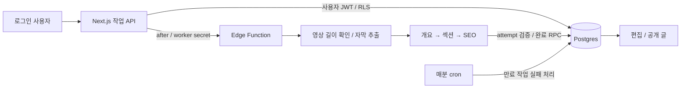
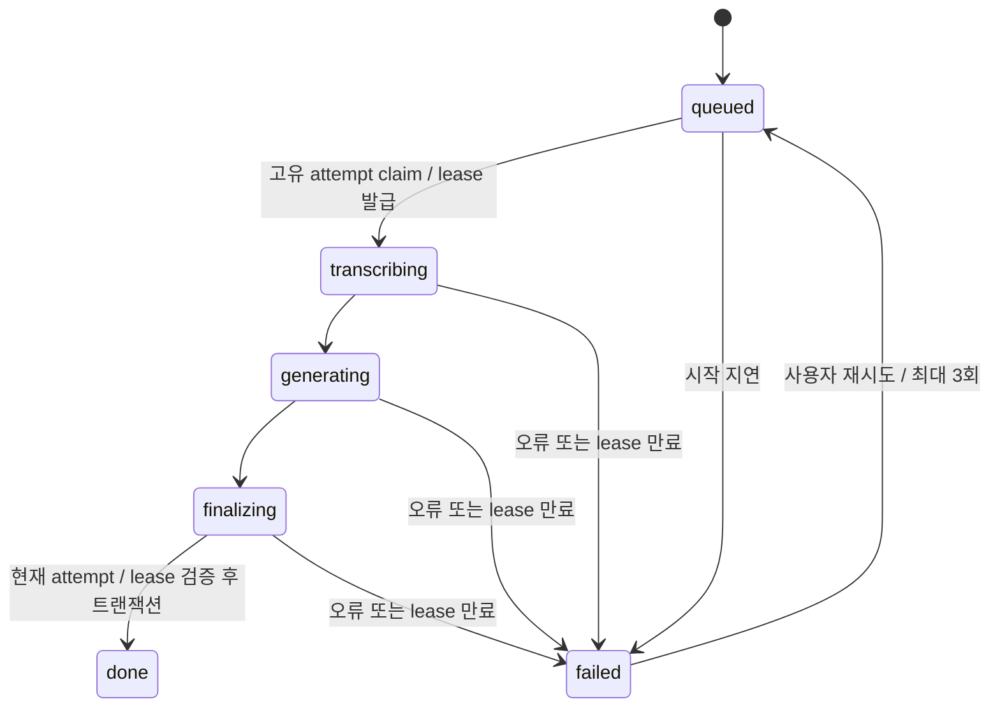

# TubeToPost

**YouTube 자막을 편집 가능한 한국어 블로그 초안으로 바꾸는 웹 서비스.**

URL 입력부터 비동기 생성, 글 편집, 공개 페이지까지 구현했습니다. 생성 성공뿐 아니라 외부 자막 공급자 오류, 중단된 작업, 중복 실행, 편집 충돌과 비용 제한을 다룹니다.

**[라이브 데모](https://tubetopost.vercel.app)** · **[검수한 공개 글](https://tubetopost.vercel.app/post/exploring-procrastin)** · [검증 기록](docs/reliability.md)

공개 글은 로그인 없이 볼 수 있습니다. 변환·편집에는 이메일 매직링크 로그인이 필요합니다. 데모 글은 AI 초안을 원문 자막과 대조해 편집했으며, 자동 생성 품질을 그대로 보여 주는 결과물과 구분해 표시했습니다.


## 사용자 흐름

1. 이메일 매직링크로 로그인합니다.
2. 20분 이하 YouTube URL을 입력합니다.
3. 자막 추출과 생성 상태를 확인합니다. 실패하면 사유를 확인하고 다시 시도할 수 있습니다.
4. 제목·Markdown 본문을 편집합니다. 자동 저장 상태와 충돌 안내를 제공합니다.
5. 공개로 전환하면 로그인 없이 읽을 수 있는 공유 페이지가 만들어집니다.

Next.js 16.4 App Router · React 19 · TypeScript · Tailwind CSS v4 · Supabase Auth / Postgres / Edge Functions · Supadata native transcript · OpenAI `gpt-4o-mini` · Vercel

## 설계: 요청과 장시간 작업 분리



Next.js는 작업을 저장한 뒤 워커를 호출합니다. 워커 호출에는 사용자 JWT와 별개의 서버 전용 secret을 사용합니다. 결과 저장·완료 전이·사용량 증가는 하나의 DB 트랜잭션으로 처리합니다.

`after`와 `waitUntil`은 영속 큐가 아닙니다. 현재는 DB 작업 상태와 만료 복구, 사용자의 수동 재시도로 중단을 처리합니다. 자동 재실행을 보장하지 않습니다.

## 설계: 이전 실행과 중복 완료 차단



- **실행 격리:** 고유 attempt ID와 lease로 늦게 끝난 이전 실행의 쓰기·완료를 차단합니다.
- **복구:** 매분 cron과 사용자 조회 시 만료된 작업을 실패로 전환합니다.
- **편집 동시성:** 자동 저장을 직렬화하고 revision이 바뀌면 409로 거절해 다른 화면의 변경을 덮어쓰지 않습니다.
- **권한:** RLS와 서버 관리 plan을 사용합니다. 일반 사용자가 계정 plan·한도를 직접 변경할 수 없습니다.
- **비용:** 사용자당 동시 1개, 월 시도 30회와 보수적인 호출 전 비용 예약을 적용합니다. 실행당 $0.05, 작업별 $0.10, 사용자 월 $1의 OpenAI 예약 상한이 있습니다. 실제 청구액 및 Supadata 크레딧과는 별개입니다.

## 검증과 문제 해결

| 검증 | 확인 결과 |
|---|---|
| 실제 변환 | TED와 TypeScript 영상의 생성 완료 |
| 입력 제한 | 짧은 원문과 20분 초과 영상은 OpenAI 생성 전에 거절 |
| 저장 경쟁 | 응답 지연 중 재편집한 최신 값 보존 |
| 저장 실패 | 네트워크 오류 후 재시도, revision 충돌 안내 |
| DB 회귀 | 권한·복구·비용·중복 완료·revision 검증 후 rollback |
| 자동 검사 | Deno 19개 테스트, lint, TypeScript 포함 프로덕션 빌드 통과 |

직접 YouTube 자막 추출이 검사한 9개 영상에서 실패해 Supadata native 경로를 도입했습니다. 오류를 무조건 ‘자막 없음’으로 처리하지 않고 공급자 제한·장애와 구분합니다. [자막 PoC 기록](docs/transcript-poc-log.md)

TED 생성문에서 강연의 뇌 그림 비유를 MRI 연구 결과처럼 서술하는 오류를 발견했습니다. 화자의 주장과 비유를 구분하도록 지시를 보강하고 실제 재생성으로 해당 오류가 사라진 것을 확인했습니다. 그래도 사실 정확성을 보장하지는 않으며 공개 전 수치·번역·용어 검토가 필요합니다. [검수한 데모 원고](docs/demo-article.md)

## 로컬 실행

```sh
pnpm install --frozen-lockfile
cp .env.local.example .env.local
# 실제 환경변수 입력
pnpm env:check
pnpm dev
```

Supabase 프로젝트에 `supabase/migrations`를 순서대로 적용하고 Edge Function을 배포해야 합니다. 기존에 적용한 마이그레이션을 다시 실행하지 않습니다. Auth에는 로컬과 운영 `/auth/callback`을 등록합니다. Next.js와 Edge Function의 `WORKER_SECRET`은 동일해야 하며 키는 커밋하지 않습니다.

```sh
pnpm lint
pnpm build
pnpm worker:check
deno test --config supabase/functions/process-job/deno.json --allow-env --allow-net --allow-read supabase/functions/process-job/worker_test.ts
```

## 현재 범위와 다음 개선

영상 길이를 확인할 수 없거나 자막을 확보하지 못하면 변환하지 않습니다. Whisper fallback·영속 큐·자동 재실행은 구현하지 않았습니다. 여러 사용자 동시 사용과 다양한 영상군의 대규모 품질 평가는 수행하지 않았습니다. 다음 개선은 원문 대비 평가 데이터 확장, 생성 후 검수 단계, 영속 큐와 모니터링입니다.

- [배포와 데모 검증](docs/deployment.md)
- [워커 배포 안내](docs/worker.md)
- [안정성 설계와 검증](docs/reliability.md)
- [개발자 테스트 계정](docs/developer-testing.md)
- [이전 구현 기록](docs/implementation.md)
