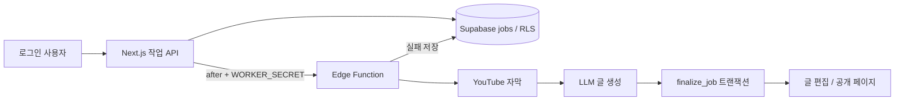

# TubeToPost

YouTube URL을 입력해 자막을 블로그 글로 변환하는 서비스입니다. 인증·작업 API·변환 워커·결과 편집과 공개 페이지를 구현했습니다.

현재 실제 테스트는 로그인 → 작업 생성 → 워커 실행 → 자막 추출 실패 안내까지 확인했습니다. 검사한 9개 영상은 자막 응답이 없거나 비어 있었으며, 실제 글 생성 완료 E2E는 아직 통과하지 못했습니다. Whisper fallback은 구현되지 않았습니다.

## 스택과 처리 흐름

Next.js 16.4 App Router / React 19 / TypeScript / Tailwind CSS v4 / Supabase Auth·Postgres·Edge Functions / OpenAI. 배포된 생성 모델은 `gpt-4o-mini`입니다.



워커 인증은 전용 공유 시크릿으로 검증합니다. DB 접근에는 플랫폼 서비스 키를 사용합니다. 작업 완료·글 저장·사용량 증가는 트랜잭션으로 처리합니다. `after`와 `waitUntil`은 내구성 있는 큐가 아니며 재시도·타임아웃 복구는 후속 작업입니다.

## 로컬 실행

```sh
pnpm install
cp .env.local.example .env.local
# 실제 환경변수 입력
pnpm env:check
pnpm dev
```

[로컬 앱](http://localhost:3000)에서 이메일 매직링크로 로그인합니다. Supabase Auth에 앱 주소와 `/auth/callback` 리다이렉트 주소를 등록해야 합니다. DB에는 `supabase/migrations`를 순서대로 적용합니다. 초기 마이그레이션을 이미 적용했다면 다시 실행하지 않습니다.

서버와 Edge Function의 `WORKER_SECRET`은 동일한 32자 이상 랜덤 값이어야 합니다. 키나 시크릿은 커밋하지 않습니다. UI는 시스템 폰트를 사용하므로 개발·빌드 중 Google Fonts 다운로드가 필요하지 않습니다.

## 검증과 배포

```sh
pnpm typecheck
pnpm lint
pnpm build
pnpm worker:check
pnpm diag:transcript <video-id>
```

자막 진단에는 Deno가 필요합니다. 진단은 서명 URL이나 시크릿을 출력하지 않습니다. 사용할 수 있는 자막이 없으면 종료 코드 1을 반환합니다.

- [워커 배포·검증 안내](docs/worker.md)
- [시연 후보 9개 검증 결과](docs/demo-videos.md)
- [이전 구현 기록](docs/implementation.md)

## 남은 작업

실제로 자막을 반환하는 공급 경로 또는 오디오 전사 fallback을 확보한 뒤 글 생성 완료, 편집, 공개 조회를 통합 검증해야 합니다. 인증된 결과 페이지에는 로딩 경계를 두고, 추출 제한을 자막 부재로 단정하지 않도록 안내합니다. 오르카 숨겨진 브라우저 탭은 프레임 갱신이 멈출 수 있으므로 시연 시 브라우저를 화면에 표시합니다.